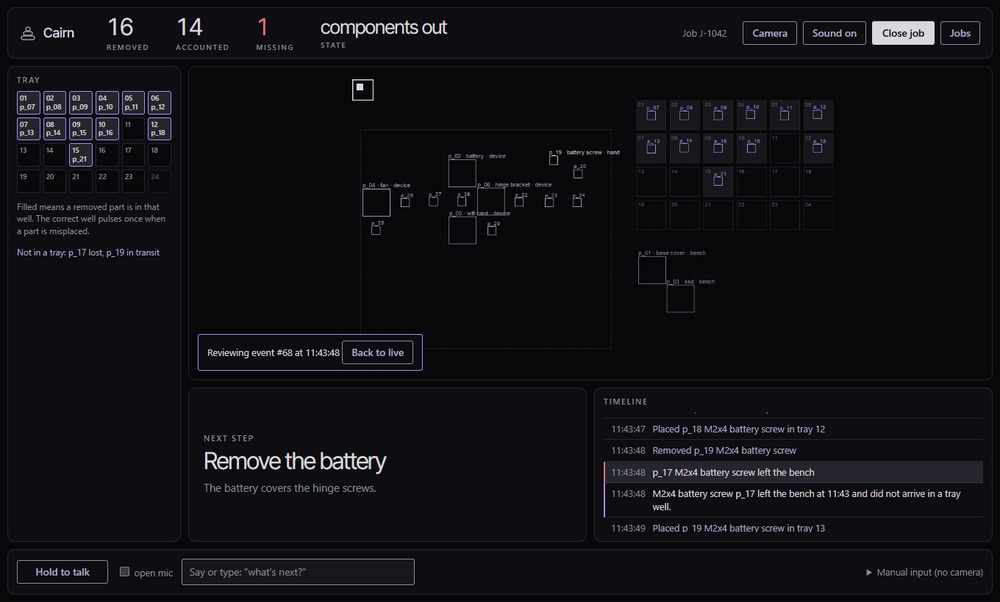
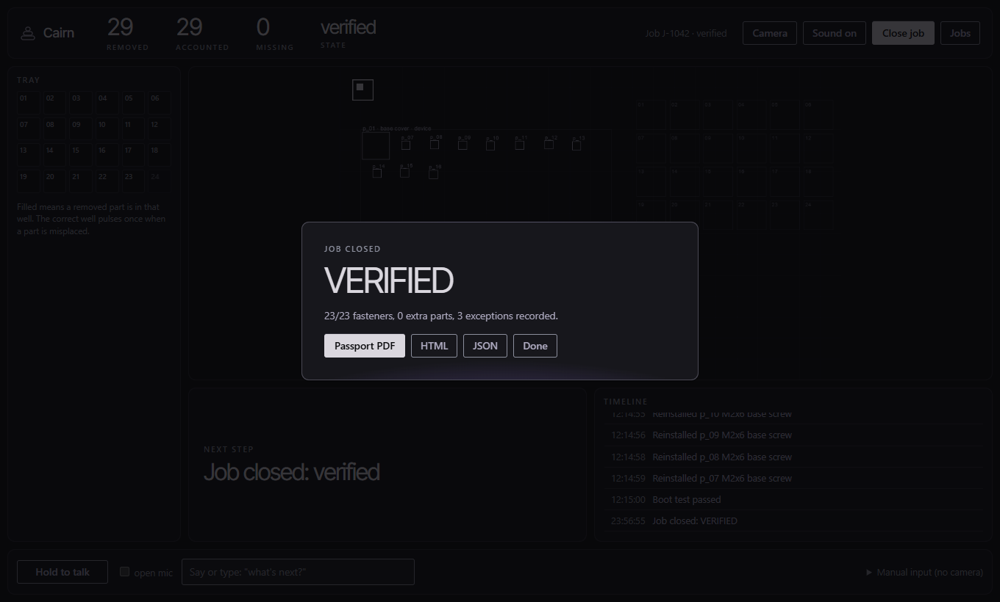

# Cairn

**Object permanence for physical work.** Cairn watches a repair bench, gives every part a persistent identity, remembers the teardown across time, catches missing, wrong or out-of-order parts, and ends with a signed, independently verifiable repair passport.

AI can design a laptop. It cannot take one apart, because it has object recognition but no object permanence: the screw it just identified is forgotten the moment it leaves the frame. Cairn is the memory layer, the safety kernel and the proof.

**Try it:** [live replay](https://cairn-ai-eta.vercel.app) (no camera, no key) · [blueprint (PDF)](docs/Cairn-Project-Blueprint.pdf) · [what is real and what is simulated](docs/PROOF.md) · [submission kit](docs/SUBMISSION.md) · [demo video, 2:31](docs/video/cairn-demo.mp4) (captioned replay of the simulated demo, [how it was made](docs/VIDEO.md))

Built for the Meta Global AI Developer Hackathon 2026. Integration targets: SAM 3.1, Muse Wonder, Muse Glimmer, Muse Voice.


*The running app replaying the **simulated** demo: REMOVED 16, ACCOUNTED 14, MISSING 1. Not a real bench.*

## Run it

```bash
docker compose up                  # http://localhost:8000  (Docker build verified 2026-11-04)
# or
pip install -e ".[server,dev]"
cairn serve                        # http://localhost:8000
```

Open it, choose **Jobs → Replay the scripted demo**, and click any timeline entry. No camera needed. The container also produces the passport PDF, so PDF fonts are not a user problem.

```bash
python -m pytest                   # 113 tests (3 more run if Playwright is installed)
cairn demo                         # scripted hero demo -> out/passport.{json,html,pdf}, repair.db
cairn verify out/passport.json --db out/repair.db
cairn eval                         # records 10 simulated sessions, replays and scores them -> eval/report.md
```

## Status (read this before quoting any number)

> - **Works, tested (113 tests, CI green on `main`):** hash-chained event log, object graph, safety kernel, five verification checks, signed passport (PDF + JSON + QR), HTTP backend, bench screen, close-job flow, Docker Compose, and an **open-bench mode for any laptop** (below).
> - **Simulated:** every session, frame, screenshot and eval number in this repo comes from a bench simulator. Nothing here is footage or measurements from a real teardown.
> - **Live Meta API.** SAM 3.1 and Muse Wonder calls succeeded on 2026-11-02 (simulated input, [`docs/PROOF.md`](docs/PROOF.md) rows 11-12b). On 2026-11-03 SAM also found the laptop, screws, fan, cables and circuit board on four public photos of open laptops, and nothing for battery, drives, back cover or memory (row 21; the photos are not in this repo). **Later the same day Meta began refusing every SAM call with `402 billing_not_configured` for the key in use: perception is down until the billing problem on the Meta developer account is fixed** (row 22). The app says so on the camera panel and in `/health`.
> - **Perception on a real teardown is unproven.** No phone camera has been run on a laptop being unscrewed. Until the kill test passes, the demo is framed as memory and verification, with perception by tap on the demo laptop.
> - **Not built:** Muse Voice, Muse Image, local-only video, a recorded real teardown. The demo video is a captioned replay of the **simulated** demo ([`docs/VIDEO.md`](docs/VIDEO.md)), not real-bench footage.


*Closing the same simulated job: the verifier passes and the passport is signed.*

## Open bench: any laptop

Start a job with the device **Any laptop (open bench)**. There is no task list: SAM looks for `laptop`, `screw`, `fan`,
`cable` and `circuit board`, each thing seen gets a slot, and the app narrates by counting ("I can see 31 screws on the
laptop", "Removed screw p_07. 30 screws still on the laptop.", "Screw p_07 is no longer on the laptop"). A part must be
missing for several seconds before it is reported, and nothing is announced if most parts vanish at once (the camera
moved). Setup, the phone-over-tunnel route and measured limits: [`docs/BENCH_SETUP.md`](docs/BENCH_SETUP.md).
Status: built and tested against scripted detections and real photos; **not run on a phone filming a real unscrewing**.

## Hosted replay

`python scripts/export_static.py` builds `site/`, a read-only static copy of the bench screen replaying the simulated demo
(real rendered frames, real state at every event, the signed passport). It is what is deployed at
https://cairn-ai-eta.vercel.app. The live backend is not on Vercel: it needs a persistent disk and a long-lived
event stream, so run it with Docker or on a host that offers both.

## Design

The front end follows the "aurora behind smoked glass" reference: a near-black void, pearl type, one violet signal, depth from surface value rather than shadow, 3px buttons and inputs, 10px cards, light-on-dark primary buttons. Tokens live in `cairn/ui/tokens.css` (the display face is self-hosted Inter Tight, a substitute for Overused Grotesk). `/` is the landing page, `/bench` the working screen. The rendered camera frames use the same palette. One deliberate deviation from the reference: critical safety states and missing parts use a single muted red, because colour is the fastest signal on a safety stop. A test (`test_pages_use_only_the_design_palette`) keeps both pages inside the palette.

## The bench screen

One view, not a chat window (`cairn/ui/bench.html`, served at `/bench`):

- **Centre:** the live bench feed with thin outlines and tiny labels, e.g. `p_04 · hinge screw · tray 04`. Camera mode overlays them on the video; server mode draws the bench.
- **Top strip:** `REMOVED · ACCOUNTED · MISSING · STATE`.
- **Left:** the 24-well tray map. The correct well pulses once when a part is misplaced.
- **Bottom left:** the next-step card, one instruction and one reason. It turns red on a safety violation.
- **Bottom right:** the timeline. Click any event to see that moment's frame and the whole screen as it was.
- **Voice bar:** push to talk (hold the button or Space) or an open mic, in a Chromium browser. Spoken alerts. A manual-input drawer covers everything the camera cannot see (ESD strap, battery disconnect, boot test) and works with no camera at all.
- **Close job:** runs the invariants and either blocks the close, produces the passport, or, if the technician writes down what they are accepting, stamps it `CLOSED WITH EXCEPTIONS`.

## Backend

Interactive docs at `/docs`. Sessions persist as one SQLite file each and reload on restart.

| Route | Purpose |
|---|---|
| `POST /sessions` (device, job number, technician), `GET /sessions[/{id}]` | start a job (snapshots the sealed device), list, snapshot |
| `POST /sessions/{id}/frames` · `/image` · `/taps` · `/baseline` | perception in: detections, a camera image (needs SAM), a human tap, the baseline picture |
| `POST /sessions/{id}/steps` · `/hazard` · `/boot-test` · `/exceptions/{x}/resolve` · `/parts/{p}/retire` | spoken or tapped actions and technician decisions |
| `POST /sessions/{id}/ask` · `/guard`, `GET /queries/{name}` | agent answers, safety pre-checks, the product queries |
| `GET /sessions/{id}/timeline` · `/at/{seq}` · `/frames/{id}.png` · `/events` · `/stream` | what the screen shows; state at any event; frames; audit log; live events |
| `POST /sessions/{id}/close`, `GET .../passport[.html\|.pdf]`, `POST /verify`, `GET /v/{id}` | close job; fetch the passport; stateless verify; the public page the QR opens |

Environment: `CAIRN_DATA_DIR`, `CAIRN_API_TOKEN` (Bearer auth on everything except `/health`, `/v/{id}` and the page),
`CAIRN_AGENT=deterministic|wonder|glimmer`, `CAIRN_PERCEPTION=none|sam` (+ `CAIRN_ZONES`), `MODEL_API_KEY`,
`CAIRN_LOCAL_URL`/`CAIRN_LOCAL_MODEL`, `CAIRN_PUBLIC_URL`, and `CAIRN_PRIVACY=local`, which refuses to start with any
component that would send bench images or prompts to a cloud API. If an LLM agent errors, answers fall back to the graph agent.

## The passport

One A4 page (PDF) plus the JSON behind it: status line (`VERIFIED` or `CLOSED WITH EXCEPTIONS`), device, job number,
technician, bench, start and end, parts removed / reinstalled / retired with counts that reconcile, every exception
with how it was resolved, four to six evidence frames (each SHA-256-pinned inside the signed body), safety checks,
the functional test, a QR code to the public verify page, and the hash chain over the event log. Ed25519-signed;
`cairn verify` and `POST /verify` check the signature, the evidence images and the chain.

## Status against the end state

| Piece | State |
|---|---|
| Event log, object graph, task graph, safety kernel, invariants, signed passport (PDF + JSON + QR) | built, tested |
| Identity tracking through dropout and new track ids; restart from the log alone | built, tested on simulated detections |
| Bench screen, tray map, timeline with frames, state at any event, close job, manual fallback | built; checked in a browser against the simulator |
| HTTP backend, auth, persistence, privacy mode, Glimmer client, Meta API clients | built, tested; live SAM and Wonder calls succeeded on 2026-11-02, then **refused with 402 billing on 2026-11-03** |
| Open bench (any laptop): discover parts, count, narrate removals | built, tested (23 tests), exercised on real photos with real SAM; **not run on a real unscrewing** |
| Eval harness on recorded-session files | built; the shipped sessions are **synthetic** |
| Docker compose | **verified 2026-11-04**: image builds, `docker compose up` is healthy, `/demo` returns a session, the passport PDF renders inside the container |
| SAM 3.1 on a real bench (Day 1 kill test) | **not done**: needs a camera and a bench |
| Camera mode in the browser | written; frames from a scripted browser stream reach the server and are narrated; **no confirmed end-to-end run with a real phone camera** |
| Voice | browser speech recognition and synthesis; Muse Voice Transcribe **not integrated** |
| Local perception (video never leaves the bench) | **not built**: SAM is a cloud API, see `docs/GLIMMER.md` |
| 3-minute video, ten real recorded teardowns, real Glimmer run, backup footage | **not done**: see `docs/SUBMISSION.md` |

## What is not proven yet

- **Perception.** Nobody has run SAM 3.1 on a real bench here. The simulator (`cairn/scenarios.py`) produces the detections SAM would, with injected dropout and track-id churn. It says nothing about real perception.
- **The eval numbers are simulated.** `eval/report.md` demonstrates the harness and the safety and memory layers, not the product.
- **Live API calls.** `cairn/meta_api.py` made successful calls on 2026-11-02 but, as of 2026-11-03, every SAM call is refused for billing. Latency was usually 3 to 6 s per picture with occasional 23 to 26 s outliers; cost per frame on a real bench is unmeasured.
- **The "no robot, no cloud box" claim** holds for everything except perception.
- **Passport trust.** The signature proves the record was not altered, not who signed it; tying a key to a real shop needs a key registry.

## Layout

```
cairn/events.py     hash-chained event log         cairn/safety.py     safety kernel
cairn/device.py     task graph, 24 wells, codes    cairn/invariants.py verification invariants
cairn/graph.py      object graph (projection)      cairn/passport.py   sign / verify / PDF / HTML / QR
cairn/session.py    reconciler + policy            cairn/agent.py      graph agent, Wonder loop
cairn/geometry.py   the bench in pixels            cairn/frames.py     frame store + renderer
cairn/timeline.py   human-readable event list      cairn/server.py     HTTP backend
cairn/ui/bench.html the single-view screen         cairn/meta_api.py   Wonder + SAM 3.1 clients
cairn/scenarios.py  bench simulator, hero demo     cairn/local_llm.py  Glimmer / local model client
cairn/evaluation.py record, replay, score          docs/               setup, Glimmer note, submission kit
```

Design rule: the model never writes to the graph. Perception proposes detections, the session decides, the log records, and the passport only issues when every invariant holds.

## Licence

MIT. See [`LICENSE`](LICENSE).
